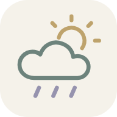
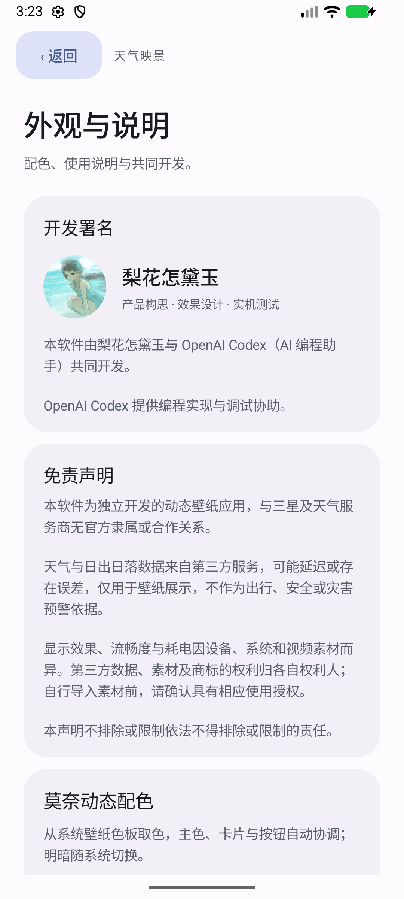

# 天气映景 · WeatherGlass



将本地视频与雨、雪、雾、晴及昼夜光线组合的 Android 动态壁纸。

**由梨花怎黛玉与 OpenAI Codex（AI 编程助手）共同开发。** 梨花怎黛玉负责产品构思、效果设计和实机测试反馈；OpenAI Codex 提供编程实现与调试协助。

> 完整源码以 Release 中的 **WeatherGlass-0.27-source.zip** 提供，解压后用 Android Studio 打开 `WeatherGlass` 文件夹。本仓库页面当前提供说明与下载，未展开源码目录。

## 下载与使用

- [下载 v0.27 beta APK](https://github.com/Narcissus521/WeatherGlass/releases/tag/v0.27-beta)
- Android 13 及以上；重点在 Galaxy S25 Ultra / Android 17 / One UI 9 上开发、验证，其他设备的壁纸应用范围和显示效果以系统为准。
- 打开应用，在“壁纸画面”选择视频，在“天气与位置”选择自动天气或固定天气，再通过系统确认页应用到锁屏。
- 预览页的天气、强度与时段选择仅用于预览，不会覆盖真实锁屏天气或关闭自动更新。

这是开发签名的测试版本。自行编译会默认使用自己的调试证书，通常不能直接覆盖本项目发布的 APK；本仓库不包含签名私钥。覆盖安装后如系统没有重新运行锁屏壁纸，可在应用中重新应用一次。

## 已有功能

- 保留视频原时长和源帧率，内置完整 20 秒、1440 × 3200、60fps 气泡视频。
- 小、中、大三档天气效果；雨珠运动与汇聚、冰窗花与哈气、雾和晴天效果。
- 根据大致所在地查询 Open-Meteo 天气及日出日落，按手机当前时间调整光线。
- 息屏或不可见时暂停；15 秒后释放解码输入缓冲，再次可见时按保存位置恢复。
- 莫奈配色、菜单和选项过渡动画、浅色线稿桌面图标，以及带作者头像的共同开发署名和免责声明。

**AOD 由系统管理。** 本应用没有三星原生 AOD 权限或独立 AOD 开关；One UI 是否在息屏显示第三方壁纸，不能仅凭普通动态壁纸服务保证。不要将此前三星原生引擎的测试结果理解为普通 APK 在所有设备上的承诺。

## 构建

这是一个独立 Java / Android 单模块工程，与 CampusFinance 无关。

1. 从 Release 下载源码压缩包并解压，用 Android Studio 打开其中的 `WeatherGlass` 文件夹。
2. 安装 Android SDK Platform 37，并让 IDE 配置本机 SDK 路径；不要提交 `local.properties`。
3. 使用 JDK 25（本项目实测为 Android Studio 自带的 OpenJDK 25.0.3）。AGP 为 9.4.1，Gradle Wrapper 为 9.6.0；Java 源码兼容级别为 11。
4. 执行：

```powershell
.\gradlew.bat :app:assembleDebug :app:lintDebug
```

macOS / Linux 使用 `./gradlew`。首次构建需要联网下载 Gradle、插件及所需 Android 工具。产物为 `app/build/outputs/apk/debug/app-debug.apk`。

纯 JVM 检查可运行 `pwsh ./tools/check-host.ps1`。`app/src/androidTest` 的 `WallpaperChecks` 会改写测试设备上的设置，**仅允许在可丢弃的模拟器中运行**，不要在日常使用的手机上执行。

## 验证与限制

0.27 已完成构建、lint、签名核对和模拟器实际说明页排版检查。0.25 的历史检查为 122 项主机检查、107 项 Android 检查；0.26 / 0.27 仅更新图标和说明页，没有将旧检查重新计作本版执行。

历史 S25 样本中，真实小雨锁屏 GL 提交约 60fps、视频纹理更新约 59–60fps，曾出现约 25ms 间隔；这不是逐帧面板呈现率或“全程零掉帧”的证明。雨天全屏预览仍有波动。息屏释放解码后进程 PSS 曾测得约 142MiB，亮屏和预览会明显增加。缓存、视频、设备和系统都会影响数据，未测得日常整机续航降幅。

## 隐私与素材

视频和头像不通过应用上传。自动天气查询使用保留两位小数的大致经纬度，发送给 `api.open-meteo.com`；后台跟随位置需要相应定位授权，关闭自动天气可停止自动查询。网络不可用时保留上次天气。

天气信息仅用于壁纸展示，不作为出行、安全或灾害预警依据。本项目独立开发，不是三星或天气服务商的官方产品。

第三方着色器、素材及标识按各自权利和原文件声明处理，见 [第三方说明](THIRD_PARTY_NOTICES.md) 及源码包内的 `LICENSES/Apache-2.0.txt`。本次公开上传没有选择覆盖整个项目的统一开源许可证；不要把仓库公开可见理解为所有素材都已获任意再分发或商用授权。

## 界面


